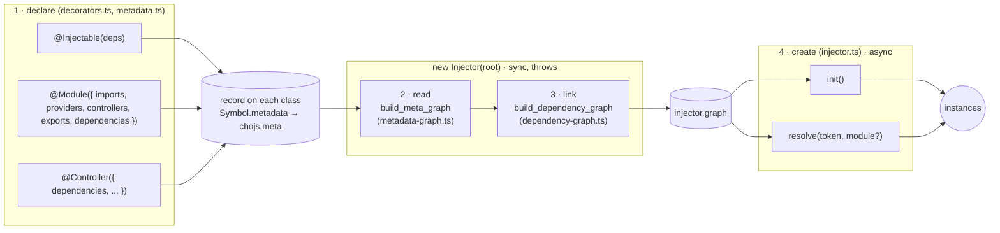
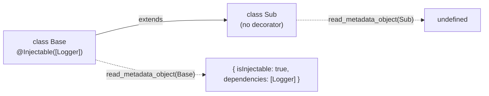
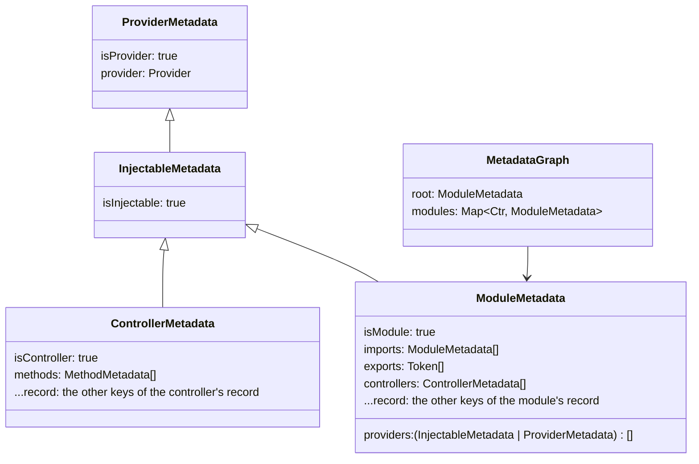
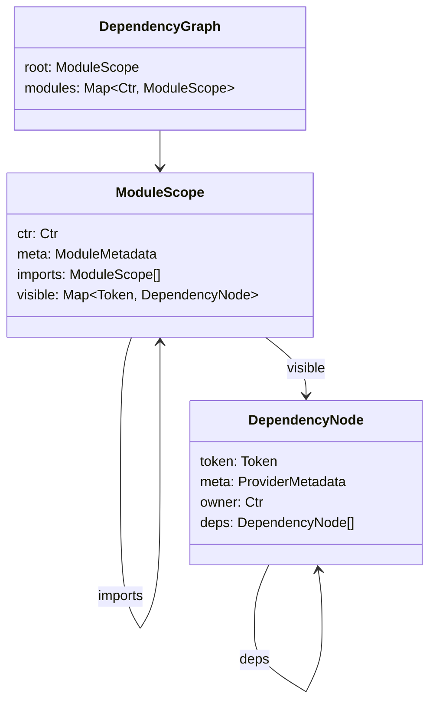
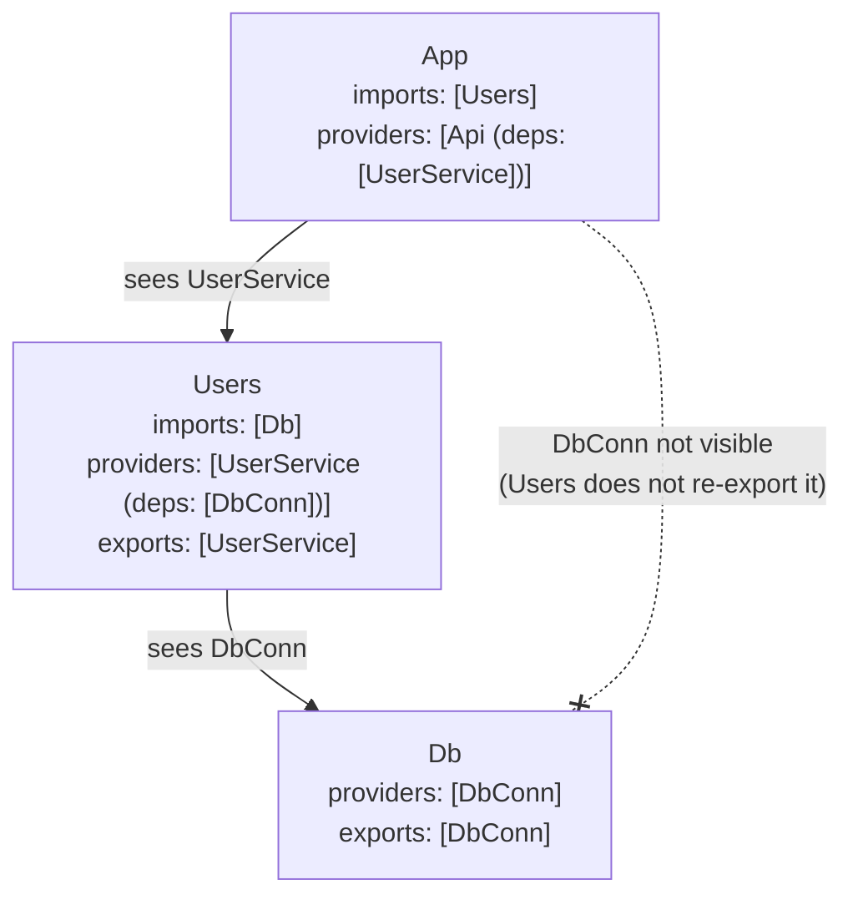
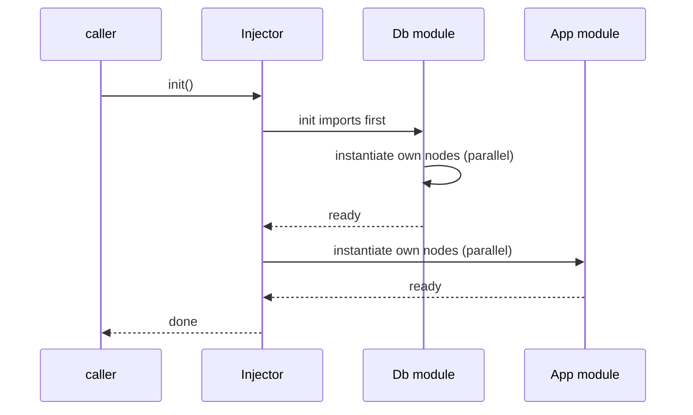
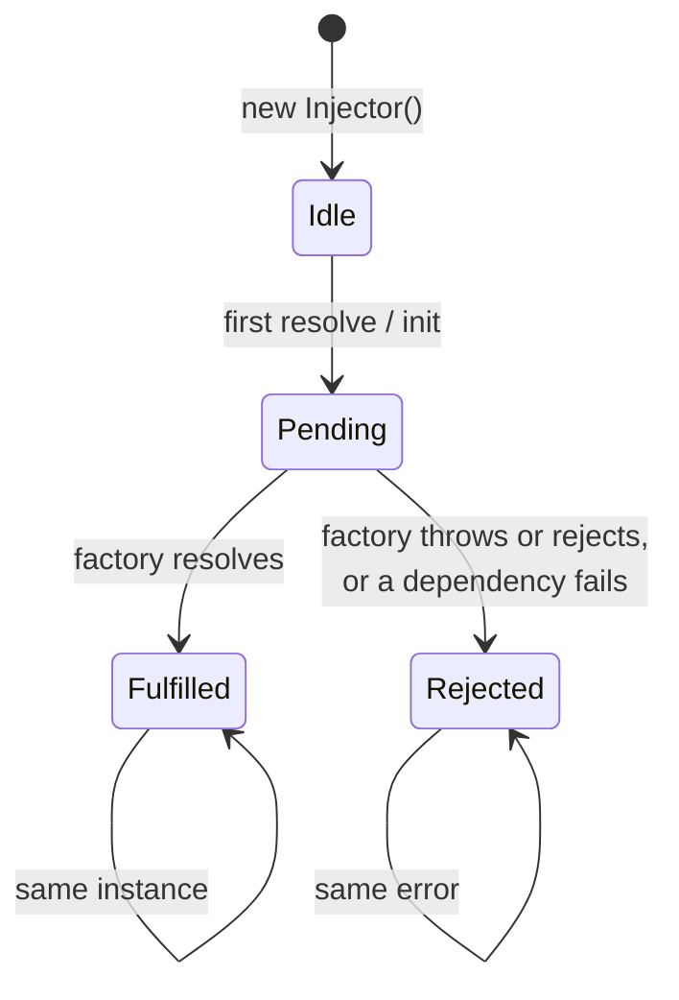

# @chojs/core Specifications

CHO is a tiny decorator-based framework for building modular applications that
runs on any JavaScript runtime (Deno, Node.js, Bun, browsers).

This document specifies the dependency injection (DI) system of the core, as
implemented in `core/di`. The source code is the reference: when this document
and the code disagree, the code wins.

## 0. Overview

Creating an injector runs a four-step pipeline. The first three steps are
synchronous and throw on any error, so a misconfigured application fails before
anything is created.



| Step    | File                  | Input               | Output                       |
| ------- | --------------------- | ------------------- | ---------------------------- |
| Declare | `di/decorators.ts`    | decorator arguments | a frozen record on the class |
| Read    | `metadata-graph.ts`   | the root module     | `MetadataGraph`              |
| Link    | `dependency-graph.ts` | `MetadataGraph`     | `DependencyGraph`            |
| Create  | `injector.ts`         | `DependencyGraph`   | instances, memoized per node |

---

## 1. Metadata storage (`metadata.ts`)

Every DI decorator records what it declares about a class in one namespaced,
frozen record.

```text
class Foo
  └─ [Symbol.metadata]                 the class's own metadata object
       └─ [Symbol.for("chojs.meta")]   the CHO record (frozen, non-enumerable)
```

### 1.1 Location

- The record lives in a TC39 decorator metadata object, under the key
  `Symbol.for("chojs.meta")`. `Symbol.for` makes every copy and version of the
  package read and write the same record.
- The metadata object key is `Symbol.metadata`, or
  `Symbol.for("Symbol.metadata")` when the runtime has no native
  `Symbol.metadata` (the same fallback esbuild and TypeScript use).
- A target is either a class (any function) or a decorator metadata object.
  - A metadata object (`context.metadata` inside a TC39 decorator) is written to
    as is.
  - For a class, the class's **own** `Symbol.metadata` property is used. When it
    is missing and a write happens, one is defined (enumerable, non-writable,
    configurable), with its prototype chained to the inherited metadata object,
    or `null`, as the TC39 specification does.

### 1.2 Own-only

A class only sees the record written to itself, never its parent's:

- reading a class without an own `Symbol.metadata` returns `undefined`, even if
  a parent class has a record;
- reading uses `Object.hasOwn` on the metadata object too, so a record inherited
  through the prototype chain of the metadata object is not seen;
- writing to a subclass never changes the parent's record.



### 1.3 Immutability

- The stored record is frozen. Top-level arrays are copied and frozen.
- Nested values (for example a provider object inside `providers`) are stored by
  reference, not copied or frozen.
- Every write replaces the record; it is never mutated in place.
- Values passed by the caller are never mutated.

### 1.4 Functions

These functions are internal (not exported from `@chojs/core`), but application
modules use them to attach their own metadata, for example to controller
methods.

| Function                              | Behavior                                                   |
| ------------------------------------- | ---------------------------------------------------------- |
| `read_metadata_object<T>(target)`     | The target's own record, or `undefined`. `T` is unchecked. |
| `write_metadata_object(target, obj)`  | Replaces the record with a frozen copy of `obj`.           |
| `add_to_metadata_object(target, obj)` | Merges `obj` into the existing record, then writes it.     |

Merge rules of `add_to_metadata_object`, per key of `obj`:

- when both the existing and the added value are arrays, they are concatenated,
  existing values first, without removing duplicates;
- any other added value replaces the existing one. Objects are not merged
  deeply;
- keys that are not in `obj` are kept.

```ts
class Foo {}

add_to_metadata_object(Foo, { a: 1, b: [2] });
add_to_metadata_object(Foo, { b: [3], c: 4 });
read_metadata_object(Foo); // { a: 1, b: [2, 3], c: 4 }

write_metadata_object(Foo, { d: 5 });
read_metadata_object(Foo); // { d: 5 }
```

### 1.5 Records written by the decorators

These types are the contract between the decorators, which write the records,
and the metadata graph, which reads them.

```ts
type InjectableDescriptor = {
  isInjectable: true;
  dependencies: readonly Dependency[]; // constructor arguments, in order
};

type ControllerDescriptor = InjectableDescriptor & {
  isController: true;
  // plus any extra keys from the @Controller options (opaque to DI)
};

type ModuleDescriptor = InjectableDescriptor & {
  isModule: true;
  imports: readonly Ctr[];
  exports: readonly Token[];
  providers: readonly (Provider | Ctr)[];
  controllers: readonly Ctr[];
  // plus any extra keys from the @Module options (opaque to DI)
};
```

Modules and controllers are injectable too: their records extend
`InjectableDescriptor`.

---

## 2. Tokens, dependencies and providers (`types.ts`, `tokens.ts`)

### 2.1 Tokens

A token identifies something injectable:

| Token                               | Value type (`Resolved<T>`) | Example                    |
| ----------------------------------- | -------------------------- | -------------------------- |
| A class (abstract classes included) | the instance type          | `Logger`                   |
| An `InjectionToken<T>`              | `T`                        | `token<string>("API_URL")` |
| A symbol                            | `unknown`                  | `Symbol("cache")`          |

```ts
type Token<T> = Ctr<T> | AbstractCtr<T> | InjectionToken<T> | symbol;
```

Strings are deliberately not tokens at the type level: unrelated packages can
pick the same string, while classes, injection tokens and symbols are unique by
identity. (At runtime, strings are not rejected; see section 9.)

### 2.2 `token<T>(description)`

- Returns a new frozen object `{ description, toString }`, branded with a
  non-enumerable `Symbol.for("chojs.token")` property set to `true`.
- `toString()` returns `InjectionToken(<description>)`, which is how the token
  appears in error messages.
- Tokens are compared by identity: two tokens with the same description are
  different tokens.
- `InjectionToken<T>` carries `T` through a phantom, type-only key that never
  exists at runtime.

### 2.3 `isToken(value)`

Returns `true` for any function (classes included), any symbol, and any object
whose `Symbol.for("chojs.token")` property is `true`, so tokens created by
another copy of the package are recognized. Strings, plain objects (even shaped
like a token) and other values return `false`.

`isToken` is exported but is not used by the decorators or the injector yet.

### 2.4 Dependencies

```ts
type Dependency = Token;
```

A dependency is a token, named by its role: lists of what a provider needs use
`Dependency`, places that name what is provided use `Token`. There is no
optional dependency: every dependency is required.

Type helpers:

- `Resolved<D>`: the value of one dependency (instance type, `T`, or `unknown`).
  It never adds `undefined`.
- `ResolvedAll<D>`: maps a tuple of dependencies to their values, in order. It
  is the argument list of a factory.

### 2.5 Providers

A provider binds a token to an async factory and the dependencies the factory
receives:

```ts
type Factory<T> = (...deps: any[]) => Promise<T>;

type Provider<T> = {
  readonly provide: Token<T>;
  readonly deps: readonly Dependency[];
  readonly factory: Factory<T>;
};
```

- A factory never resolves anything itself. It receives the values of `deps` as
  arguments, in order.
- A factory returns a promise, so creating a value can include asynchronous
  initialization.

### 2.6 `provider({ provide, deps?, factory })`

A typing helper. At runtime it returns a new object, a shallow copy of the input
with `deps` defaulting to `[]`; the input is not changed. In the types:

- the factory arguments are inferred from `deps` (`ResolvedAll<D>`, with `D`
  inferred as a `const` tuple);
- the factory must return `Promise<T>`, where `T` is the token's type.

```ts
const API_URL = token<string>("API_URL");

provider({
  provide: API_URL,
  deps: [Config],
  factory: (config) => Promise.resolve(config.apiUrl), // config: Config
});
```

---

## 3. Decorators (`di/decorators.ts`)

Decorators only declare. Each one writes a record (section 1.5) and nothing
else: no instance is created, and nothing is validated beyond the "one DI
decorator" rule.

### 3.1 Common rules

- **Both decorator implementations.** A decorator is a `ChoClassDecorator`,
  `(target, context?) => void`. With TC39 decorators the record is written to
  `context.metadata`; with legacy (`experimentalDecorators`) or Bun decorators,
  or a plain call, `context` is `undefined` and the record is written to the
  class.
- **One DI decorator per class.** Dependencies are positional constructor
  arguments, so two dependency lists can never be combined. Applying
  `@Injectable`, `@Module` or `@Controller` to a target whose record already has
  `isInjectable` throws:
  `@<Decorator>: class is already decorated with @Injectable, @Module or @Controller`.
- **Own-only.** A subclass of a decorated class is not decorated, and can get
  its own DI decorator.
- The record is written with `add_to_metadata_object`, so keys written earlier
  by other code (for example an application module) are kept.

### 3.2 `@Injectable(dependencies = [])`

Takes the dependency array directly. Writes
`{ isInjectable: true, dependencies }`.

```ts
const PORT = token<number>("PORT");

@Injectable([Logger, PORT])
class Server {
  constructor(logger: Logger, port: number) {}
}
```

### 3.3 `@Module(options = {})`

Takes `Partial<ModuleOptions>`:
`{ dependencies?, imports?, providers?, controllers?, exports?, [key: string]: unknown }`.
The lists default to `[]`:

| Option         | Meaning                                                           |
| -------------- | ----------------------------------------------------------------- |
| `dependencies` | the module's own constructor arguments, resolved in its own scope |
| `imports`      | modules whose exported tokens this module can inject              |
| `providers`    | `@Injectable` classes and provider objects this module declares   |
| `controllers`  | `@Controller` classes this module declares                        |
| `exports`      | tokens that modules importing this one can inject                 |

Writes
`{ isInjectable: true, dependencies, ...options, isModule: true, imports, exports, providers, controllers }`.
Any extra option (such as a web route prefix) is stored as is, for the
application module; DI ignores it. The flags and `dependencies` cannot be set or
duplicated through the options: `isInjectable` and `dependencies` are written by
the `@Injectable` step only, and the module keys are written after the extra
options.

### 3.4 `@Controller(options = {})`

A controller is an entry point of an application, a class whose methods an
application module invokes (for example a CLI command handler).

- Takes `Partial<ControllerOptions>`:
  `{ dependencies?, [key: string]: unknown }`.
- Writes `{ isInjectable: true, isController: true, ...options, dependencies }`,
  with `dependencies` defaulting to `[]`. Any extra option is stored as is, for
  the application module; DI ignores it. `...options` is spread after the flags,
  so an option named `isInjectable` or `isController` overwrites them.
- Application modules can also attach metadata to the controller's methods by
  writing a record on the method function (for example
  `write_metadata_object(Cli.prototype.run, {...})`). The metadata graph
  collects it (section 4.2).

```ts
@Controller({ dependencies: [Logger] })
class Cli {
  constructor(logger: Logger) {}
}

@Module({ providers: [Logger], controllers: [Cli] })
class App {}
```

Note the asymmetry: `@Injectable` takes an array, `@Module` and `@Controller`
take an options object.

---

## 4. Read: the metadata graph (`metadata-graph.ts`)

`build_meta_graph(root)` reads the records from the root module, following
`imports` depth first, validates them, and normalizes every declaration into a
provider.

### 4.1 Normalized types



- A **provider object** listed in `providers` becomes
  `{ isProvider: true, provider }`, with the object kept by reference, as is.
- A **class** becomes a provider whose token is the class, whose `deps` are the
  `dependencies` of its record, and whose factory constructs it:
  `async (...args) => Reflect.construct(ctr, args)`. Because the factory is
  `async`, a constructor that throws produces a rejected promise.
- `MethodMetadata` is `{ name, meta }`.

### 4.2 Algorithm

`module_metadata(mdl, modules, path)`:

1. If `mdl` is not a function, throw
   `TypeError: Expected a module class, got <typeof>`.
2. If `mdl` is on the current import `path`, throw
   `Circular dependency detected: A → B → A` (module names). This is checked
   before the cache, since a module on the path is not cached yet. A module that
   imports itself is a cycle.
3. If `mdl` was already normalized (a diamond), return the cached metadata.
4. If its record has no `isModule`, throw
   `Class X is not a module. Did you forget @Module?`.
5. Build the normalized module, in this order:
   1. `exports`: the declared tokens, as is (not validated here);
   2. `imports`: each import normalized recursively, in order;
   3. `providers`: each entry normalized, in order. A function whose record has
      no `isInjectable` throws
      `Class X is not injectable. Did you forget @Injectable?`. `@Module` and
      `@Controller` classes are accepted, since they are injectable;
   4. `controllers`: each entry normalized, in order. A non-function throws
      `TypeError: Expected a controller class, got <typeof>`; a class without
      `isController` throws
      `Class X is not a controller. Did you forget @Controller?`;
   5. `provider`: the module itself, as a class provider.

   Every other key of the module's record (extra `@Module` options, or what
   `@Catch`, `@Middlewares` and application modules wrote on the class) is kept
   as is. The normalized keys are set after them, so a record key never
   overrides them.
6. Cache the module and return it.

Controller methods: the own property descriptors of `ctr.prototype` are scanned,
in declaration order. The constructor, accessors and non-function values are
skipped, and so are methods whose function has no record. Inherited methods are
not collected.

The result is `{ root, modules }`. `modules` is in post-order: imports before
the modules that import them, the root last. A module imported through several
paths appears once.

---

## 5. Link: the dependency graph (`dependency-graph.ts`)

`build_dependency_graph(metaGraph)` turns the metadata graph into nodes, groups
them by module into scopes, and links every dependency, once, to the node that
provides it. Creating instances later needs no lookup.

### 5.1 Data model



- A **node** is one declaration (a provider, a controller or the module class)
  in one module. It stands for one instance. The same class declared in two
  modules is two nodes, and two instances.
- `owner` is the declaring module. The node's dependencies were resolved in its
  scope.
- `deps` are the nodes that provide the dependencies, in the order the factory
  receives them.
- A **scope** is one module. A module imported through several paths is one
  scope, shared by all its importers. `modules` is in post-order, root last.
- `visible` maps every token the module can inject to its node: its own
  declarations and the tokens its direct imports export. Ambiguous tokens are
  left out. It is filled during the build and read-only afterwards.

### 5.2 Scope rules

- **What a module sees.** Its own declarations (providers, controllers and the
  module class itself), plus the tokens its **direct** imports **export**. A
  token an import does not export stays private to that import. Visibility is
  not transitive: a module sees an import's import only through re-exports.
- **Own declarations win.** A token the module declares shadows the same token
  exported by an import. This is how a module overrides an imported provider.
- **Where dependencies resolve.** Always in the scope of the declaring module,
  never in the scope of an importer. An exported provider keeps its own module's
  dependencies, so overriding a token in an importer does not rewire nodes that
  an import already linked.
- **No upward visibility.** A module never sees what the modules importing it
  provide.
- **What a module can export.** Any token in its scope: one it declares (the
  module class itself and its controllers included), or one it imports (a
  re-export). Exporting a whole imported module is not supported.



### 5.3 Ambiguous tokens

Two imports can export the same token:

- if both pass on the **same node** (for example both re-export a token of a
  shared module), it is one instance: the token is visible;
- if they pass on **different nodes**, the token is ambiguous: it is left out of
  `visible`. Injecting or exporting it throws (lazily, only when used), naming
  every exporting module:
  `X is ambiguous in module M: A, B export different instances of it. Provide X in M to choose which one to use.`
- an unused ambiguous token is not an error;
- declaring the token in the module itself settles the ambiguity.

### 5.4 Algorithm

`build_module_scope(meta, scopes, path)`, per module:

0. Throw `Circular dependency detected: A → B → A` if the module is on the path
   (a guard; `build_meta_graph` already rejects this). Return the cached scope
   of a module already built.
1. **Imports.** Build the imported scopes first, in order.
2. **Imported tokens.** Collect the exports of each import, as nodes from the
   import's `visible`, and detect ambiguous tokens (section 5.3).
3. **Own declarations.** Create one node per provider, then per controller, then
   for the module itself, all owned by this module, and add them to `visible`
   (shadowing imported tokens). A token declared twice throws
   `X is declared more than once in module M (as <first> and as <second>). Declare each token once.`,
   where each kind is `a provider`, `a controller` or `the module itself`. This
   catches a token listed twice in `providers`, a controller listed twice, a
   provider and a controller with the same token, and a provider whose token is
   the module class. Declared tokens are removed from the ambiguous set.
4. **Exports.** Each exported token must be in scope:
   - an ambiguous token throws the ambiguity error;
   - an imported module class throws
     `Module M exports the imported module X. Re-exporting a module is not supported; export the tokens you need instead.`;
   - anything else not in scope throws
     `Module M exports X, which it neither provides nor imports.`

   The root module's exports are checked too.
5. **Link.** For each node this module declares (only those: imported nodes are
   linked in their own module), map each of `provider.deps` (`[]` when missing,
   for provider objects written in plain JavaScript) to its node in this scope.
   An ambiguous dependency throws the ambiguity error; a missing one throws
   `Cannot resolve X (argument #i) of Y in module M. Provide it there or import a module that exports it.`
   (`i` is zero-based).
6. **Cycles.** A depth-first search over `deps`, from the nodes this module
   declares. Reaching a node on the current path throws
   `Circular dependency detected in module M: A → B → A`, where `M` is the owner
   of the node that closes the cycle. Imported nodes cannot depend back on this
   module, so a new cycle always runs through this module's nodes. A module that
   depends on itself, or on a provider that depends on the module, is a cycle.
7. Cache the scope and return it.

Error order: the metadata graph is fully built first (section 4). Then modules
are linked in post-order, and each module runs steps 1 to 6 before the next one
starts.

---

## 6. Create: the injector (`injector.ts`)

```ts
class Injector {
  constructor(root: Ctr);
  readonly graph: DependencyGraph;
  init(): Promise<void>;
  resolve<T>(token: Token<T>, module?: Ctr): Promise<T>;
  controllers(): IterableIterator<DependencyNode<ControllerMetadata>>;
}
```

### 6.1 Constructor

`new Injector(root)` runs `build_dependency_graph(build_meta_graph(root))` and
stores the result in `graph`. It is synchronous, throws every wiring error
(sections 4 and 5), and creates nothing.

Instances belong to the injector. There is no global state: two injectors for
the same root module share no instances.

### 6.2 `resolve(token, module?)`

1. The scope is `graph.modules.get(module)` when `module` is given, otherwise
   the root scope. A module that is not part of the application rejects with
   `M is not part of this application`.
2. The token is looked up in the scope's `visible` table. A token that is not
   there rejects with `X is not visible in module M`. This includes tokens an
   import keeps private, ambiguous tokens, and non-token values such as strings.
3. The node is instantiated (section 6.4) and its value returned.

`resolve` is `async`, so every failure, a failed lookup included, is a
rejection, never a synchronous throw. `T` is inferred from the token: the
instance type for a class, `T` for an `InjectionToken<T>`, `unknown` for a
symbol.

`resolve` creates only what the token needs: the node and its dependencies,
transitively. Nothing else.

```ts
const users = await injector.resolve(UserService);
const url = await injector.resolve(API_URL); // string
const cli = await injector.resolve(Cli, CliModule); // in CliModule's scope
```

### 6.3 `init()`

Creates every module with everything it declares, used or not: its providers,
its controllers and the module itself.

- A module is initialized only after all its imports are, so imported modules
  are always ready first. Sibling imports are initialized in parallel.
- Within a module, every node it owns (the `visible` nodes whose `owner` is the
  module) is instantiated in parallel; each node waits for its own dependencies.
- Each module's initialization is memoized by scope, its promise stored before
  anything is awaited: a module imported through several paths is initialized
  once, and calling `init()` more than once, or concurrently, creates nothing
  twice.
- `init()` and `resolve()` share instances. `resolve()` does not require
  `init()`, but calling `init()` at startup surfaces every factory error early.
- A failing factory rejects `init()` with the wrapped error (section 6.5).



### 6.4 Instantiation

- Each node's creation is memoized in a per-injector
  `Map<DependencyNode, Promise>`. The promise is stored before anything is
  awaited, so concurrent and later requests share one creation and one instance.
  This relies on the graph being acyclic.
- A node's dependencies are instantiated in parallel, then its factory is called
  with their values, in declared order.
- A dependency shared by several nodes is created once.

### 6.5 Failures



- A factory that throws or rejects (a throwing constructor included) is wrapped
  as `Failed to create X in module M`, where `M` is the node's owner, with the
  original error as `cause`.
- A failing dependency is passed through as is: a dependent rejects with the
  original wrapped error, which names the node that actually failed, and its
  factory is not called.
- **There is no retry.** The rejection is memoized: every later request for the
  node, or for anything that depends on it, gets the same error, and the factory
  runs once.

### 6.6 `controllers()`

A generator over the controller nodes of the application: for each module in
`graph.modules` (post-order), every node of its `visible` table whose metadata
has `isController`. The node gives the controller class (`token`), its module
(`owner`) and its method metadata (`meta.methods`); application modules create
the controller with `resolve(node.token, node.owner)`.

### 6.7 Controllers are ordinary nodes

DI does not treat controllers specially beyond normalization: a controller node
is in its module's `visible` table, so it can be resolved with `resolve`, a
provider of the same module can depend on it, and a module can export it.

---

## 7. Public API (`mod.ts`)

`@chojs/core` (`core/mod.ts`) re-exports `di/mod.ts`.

Runtime values: `Injectable`, `Module`, `Controller`, `Injector`, `token`,
`provider`, `isToken`.

Types:

- options: `InjectableOptions`, `ModuleOptions`, `ControllerOptions`;
- core types: `Token`, `InjectionToken`, `Dependency`, `Provider`, `Factory`,
  `Resolved`, `ResolvedAll`, `Ctr`, `AbstractCtr`, `ChoClassDecorator`;
- graph types, public because `Injector.graph` exposes the graph:
  `ProviderMetadata`, `InjectableMetadata`, `ControllerMetadata`,
  `ModuleMetadata`, `MethodMetadata`, `DependencyGraph`, `DependencyNode`,
  `ModuleScope`.

The metadata storage functions (section 1.4), `build_meta_graph`,
`build_dependency_graph` and `MetadataGraph` are not exported.

Quick start:

```ts
import { Injectable, Injector, Module, provider, token } from "@chojs/core";

const GREETING = token<string>("greeting");

@Module({
  providers: [
    provider({ provide: GREETING, factory: () => Promise.resolve("hello") }),
  ],
  exports: [GREETING],
})
class GreetingModule {}

@Injectable([GREETING])
class Greeter {
  constructor(readonly greeting: string) {}
}

@Module({ imports: [GreetingModule], providers: [Greeter] })
class App {}

const injector = new Injector(App);
await injector.init();
const greeter = await injector.resolve(Greeter); // greeter.greeting === "hello"
```

---

## 8. Errors

Values in messages are rendered by `describe` (`utils/describe.ts`): functions
by name (or `<anonymous>`), strings JSON-quoted, everything else with `String()`
(so `InjectionToken(description)` and `Symbol(description)`). Some
metadata-graph messages use `ctr.name` directly, so an anonymous class shows an
empty name there.

### 8.1 Thrown by decorators

| Condition           | Message                                                                             |
| ------------------- | ----------------------------------------------------------------------------------- |
| Second DI decorator | `@<Decorator>: class is already decorated with @Injectable, @Module or @Controller` |

### 8.2 Thrown by `new Injector()`: read (section 4)

| Condition                        | Message                                                    |
| -------------------------------- | ---------------------------------------------------------- |
| Root or import is not a function | `TypeError: Expected a module class, got <typeof>`         |
| Circular import                  | `Circular dependency detected: A → B → A`                  |
| Not a module                     | `Class X is not a module. Did you forget @Module?`         |
| Provider class not injectable    | `Class X is not injectable. Did you forget @Injectable?`   |
| Controller entry not a function  | `TypeError: Expected a controller class, got <typeof>`     |
| Not a controller                 | `Class X is not a controller. Did you forget @Controller?` |

### 8.3 Thrown by `new Injector()`: link (section 5)

| Condition             | Message                                                                                                               |
| --------------------- | --------------------------------------------------------------------------------------------------------------------- |
| Duplicate declaration | `X is declared more than once in module M (as <kind> and as <kind>). Declare each token once.`                        |
| Ambiguous token used  | `X is ambiguous in module M: A, B export different instances of it. Provide X in M to choose which one to use.`       |
| Re-exported module    | `Module M exports the imported module X. Re-exporting a module is not supported; export the tokens you need instead.` |
| Export not in scope   | `Module M exports X, which it neither provides nor imports.`                                                          |
| Missing dependency    | `Cannot resolve X (argument #i) of Y in module M. Provide it there or import a module that exports it.`               |
| Circular dependency   | `Circular dependency detected in module M: A → B → A`                                                                 |

### 8.4 Raised by `resolve()` and `init()` (as rejections)

| Condition         | Message                                        |
| ----------------- | ---------------------------------------------- |
| Unknown module    | `M is not part of this application`            |
| Token not visible | `X is not visible in module M`                 |
| Factory failure   | `Failed to create X in module M`, with `cause` |

---

## 9. Known gaps

Behaviors of the current code that are not enforced or are likely unintended.
They are listed so the specification stays truthful; they are not guarantees.

- **Controllers are injectable.** Nothing prevents a provider from depending on
  a controller or `resolve()` from creating one (section 6.7).
- **Ambiguity at resolve time.** `resolve()` reports an ambiguous token as
  `not visible`, not as ambiguous.
- **`@Controller` options can overwrite its flags.** Options are spread after
  `isInjectable` and `isController`.
- **No debug logging.** `utils/debuglog.ts` exists, but the injector does not
  log.
