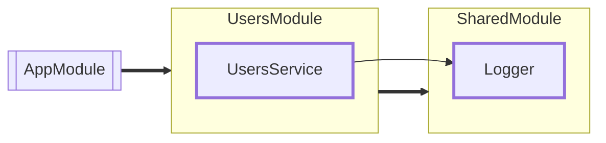

# @chojs/dev

[](https://jsr.io/@chojs/dev)
[](https://jsr.io/@chojs/dev)
[](./LICENSE)

Tools for developing and debugging a CHO application: the list of its endpoints,
and its graph, drawn on a page that filters by kind and by search.

They read the metadata the decorators wrote. **No instance is created and no
application is started**: a root module class is enough, and the database the
application would connect to is never asked for.

## Contents

- [Installation](#installation)
- [The endpoints](#the-endpoints)
- [The graph, as a page](#the-graph-as-a-page)
- [The graph, on a web application](#the-graph-on-a-web-application)
- [The graph, as text](#the-graph-as-text)
- [The model](#the-model)
- [Filtering](#filtering)
- [A broken application](#a-broken-application)
- [What the tools take](#what-the-tools-take)
- [Errors](#errors)
- [Runtime support](#runtime-support)
- [Documentation](#documentation)

## Installation

```sh
deno add jsr:@chojs/dev    # Deno
npx jsr add @chojs/dev     # Node.js
bunx jsr add @chojs/dev    # Bun
```

The package depends on `@chojs/core` alone. It reads what the decorators of
`@chojs/web`, `@chojs/message` and `@chojs/command` wrote without importing
them: an application of one kind does not install the other two.

## The endpoints

```ts
import { printEndpoints } from "@chojs/dev";

printEndpoints(AppModule);
```

```text
HTTP
GET   /users          UsersController.list     UsersModule    auth
GET   /users/:id      UsersController.get      UsersModule    auth
POST  /users          UsersController.create   UsersModule    auth
WS    /support/:room  SupportController.join   SupportModule

MESSAGE
orders.paid       OrdersEvents.paid       OrdersModule
orders.cancelled  OrdersEvents.cancelled  OrdersModule
```

Every endpoint the controllers declare: the HTTP routes (`@Get`, `@Post`, ...),
the streams of events (`@Sse`), the WebSockets (`@Ws`), the message topics
(`@Subscribe`) and the commands (`@Main`, `@Action`). A line has what is
reached, the method that handles it, its module, and the middlewares that run
for it, in order: those of the module, of the controller and of the method.

| Function                            | Gives                                    |
| ----------------------------------- | ---------------------------------------- |
| `printEndpoints(target, options?)`  | The table, written with `console.log`    |
| `formatEndpoints(target, options?)` | The table, as a string                   |
| `endpoints(target)`                 | The endpoints, as data: `ChoDevEndpoint` |

The one option is `types`, the types to show: `"http"`, `"sse"`, `"ws"`,
`"message"`, `"command"`.

```ts
for (const endpoint of endpoints(AppModule)) {
  endpoint.type; // "http"
  endpoint.method; // "GET"
  endpoint.path; // "/users/:id"
  endpoint.handler; // "get"
  endpoint.middlewares; // ["auth"]
  endpoint.errorHandler; // the nearest @Catch, or null
}
```

## The graph, as a page

```ts
import { graphPage } from "@chojs/dev";

await Deno.writeTextFile("graph.html", graphPage(AppModule));
```

`graphPage` returns one HTML file, with the model of the application inside it.
Write it to a file and open it, or serve it.

- **A module is a box** that holds its providers, its controllers and their
  endpoints.
- **A thick arrow is an import.** A thin arrow goes from what injects to what is
  injected. A dotted line joins a controller to its endpoints. A double border
  marks what a module exports.
- **The switches** hide the providers, the controllers, the endpoints or the
  dependencies. An application with more than one type of endpoint has a switch
  for each: HTTP, SSE, WebSocket, messages, commands.
- **The search** lights what it finds: a name, a path, a topic, a command, or
  the name of a module, which finds all the module declares. A switch hides the
  rest instead. `/` goes to the search.
- **Selecting a node** shows what it injects, what injects it, what exports it,
  its middlewares and its error handler, and lights what is next to it. "Only
  this and what is near" draws the node with what is one to four steps away.
- **The address of the page keeps the view**: the switches, the search and the
  selection. A view can be sent, and it is there after a reload.

| Option   | Default                     | What it is                                 |
| -------- | --------------------------- | ------------------------------------------ |
| `title`  | the name of the root module | The title of the page                      |
| `assets` | the CDN                     | Where the three files of the libraries are |

The drawing is made in the browser by [Cytoscape.js](https://js.cytoscape.org),
with the layered layout of [ELK](https://eclipse.dev/elk/). The page loads them
from jsDelivr, at the exact versions of `PAGE_VERSIONS`: it needs the network.
To host them, give `assets` the address of a folder that has `cytoscape.min.js`,
`elk.bundled.js` and `cytoscape-elk.js`.

No name of the application is written as HTML: a class can have any name.

## The graph, on a web application

```ts
import { ChoWeb } from "@chojs/web";
import { serve } from "@chojs/web/serve";
import { devRoutes } from "@chojs/dev";

const app = await ChoWeb.create(AppModule);
devRoutes(app);
// GET /__cho             the page
// GET /__cho/graph.json  the model

await serve(app);
```

`devRoutes` mounts the page on the application, with `app.mount`. It takes the
options of the page, and two of its own:

| Option        | Default   | What it is                                               |
| ------------- | --------- | -------------------------------------------------------- |
| `route`       | `"__cho"` | The base route. It is not under the global prefix        |
| `middlewares` | none      | Middleware functions of `@chojs/web`, for the two routes |

An application as the target adds what only it knows: the global prefix is in
the paths, and the routes that were mounted before are listed.

> **It is for development.** The page shows the structure of the application to
> whoever can reach the route. Do not mount it in production, or give it an
> authentication with `middlewares`.

## The graph, as text

For the tools that draw a graph themselves:

```ts
import { toDot, toMermaid } from "@chojs/dev";

toMermaid(AppModule, { kinds: ["module"] }); // GitHub draws it in a Markdown file
toDot(AppModule); // dot -Tsvg app.dot -o app.svg
```



Both take a filter as their second argument, and both are strings: nothing is
installed.

## The model

Everything above is made of one model:

```ts
import { inspect } from "@chojs/dev";

const graph = inspect(AppModule);
graph.root; // "AppModule"
graph.nodes; // modules, providers, controllers, endpoints
graph.edges; // imports, exports, injects
graph.error; // null, or what is wrong with the application
```

It is plain data, that `JSON.stringify` writes whole. So a test can keep the
shape of an application:

```ts
assertEquals(
  inspect(AppModule),
  JSON.parse(await Deno.readTextFile("graph.json")),
);
```

| Node         | What it is                                   | Its own fields                                        |
| ------------ | -------------------------------------------- | ----------------------------------------------------- |
| `module`     | A module                                     | `root`, `middlewares`, `errorHandler`                 |
| `provider`   | An `@Injectable` class, or a provider object | `token`: `"class"`, `"token"` or `"symbol"`           |
| `controller` | A controller                                 | `middlewares`, `errorHandler`                         |
| `endpoint`   | A method something outside can reach         | `type`, `controller`, `handler`, `path`, `topic`, ... |
| `missing`    | What a module asks for and nothing gives     |                                                       |

Every node has an `id`, a `name`, and `module`: the id of the module that
declares it. Ids are readable, and the same from one run to the next:
`"UsersModule/UsersService"`, `"UsersModule/UsersController.list"`.

| Edge      | From          | To                                          |
| --------- | ------------- | ------------------------------------------- |
| `imports` | A module      | A module it imports                         |
| `exports` | A module      | What it exports: its own, or one it imports |
| `injects` | A declaration | Each of its dependencies, in order          |

A dependency is resolved by the core, with the scope rules of the modules: an
edge leads to the provider an injector would use. A class two modules declare is
two nodes, as it is two instances.

## Filtering

```ts
import { filterGraph } from "@chojs/dev";

filterGraph(AppModule, { kinds: ["module"] }); // what imports what
filterGraph(AppModule, { search: "orders" });
filterGraph(AppModule, { around: "UsersModule/UsersService", depth: 2 });
```

| Rule     | Keeps                                                                                  |
| -------- | -------------------------------------------------------------------------------------- |
| `kinds`  | The kinds of nodes, and the types of endpoints, that are named                         |
| `search` | What has the text, with no regard to case, in its name, path, topic, command or module |
| `around` | One node, and what is within `depth` steps of it (default `1`)                         |

A node must pass every rule that is given. A node that is kept keeps its module,
and an endpoint its controller. An edge is kept when both its ends are.

## A broken application

An application whose dependencies cannot be linked is the one a developer most
wants to see. `inspect` reads it, and so do all the tools:

```ts
const graph = inspect(AppModule);
graph.error;
// { code: "CHO_CORE_UNRESOLVED_DEPENDENCY",
//   message: "Cannot resolve Mailer (argument #0) of OrdersService in module OrdersModule. ..." }
```

The error is the one an injector would throw. Each dependency is then found
where it most likely is: in the module, then among what its imports export. What
is found nowhere, and a token two imports export, is a node of kind `"missing"`:
the page draws it in red, with a dashed border, and shows the error at the top.

When the metadata itself is invalid, there is nothing to draw: a class without
its decorator, or circular imports, throws the error of the core.

## What the tools take

| Target              | What is read                                                          |
| ------------------- | --------------------------------------------------------------------- |
| A root module class | Its metadata. The usual one                                           |
| An `Injector`       | Its two graphs. Nothing is created, whether it was initialized or not |
| An application      | The graphs of its injector, its global prefix and its mounted routes  |
| A model             | Itself: `inspect` it once, and give it to several tools               |

An application is a `ChoWeb` or a `ChoMessage`. A `ChoCommand` keeps its
injector to itself: give its root module.

## Errors

A mistake is a `ChoError`: an `Error` with a stable `code`.

```ts
import { isChoError } from "@chojs/core";

try {
  printEndpoints(target);
} catch (error) {
  if (isChoError(error, "CHO_DEV_INVALID_TARGET")) {
    // ...
  }
  throw error;
}
```

| Mistake                                              | Code                     |
| ---------------------------------------------------- | ------------------------ |
| A target that is not a module, an injector or an app | `CHO_DEV_INVALID_TARGET` |
| An option or a rule of a filter that is wrong        | `CHO_DEV_INVALID_OPTION` |
| `around` a node the model has not                    | `CHO_DEV_UNKNOWN_NODE`   |

An option that does not exist is `CHO_CORE_UNKNOWN_OPTION`, a class that is not
a module is `CHO_CORE_NOT_A_MODULE`, and a route that is not valid or already
taken has the code of `app.mount` (`CHO_WEB_…`). The messages are in the
[specification](./specs.md#8-errors).

## Runtime support

Deno, Node.js, Bun, Cloudflare Workers and other edge runtimes: the tools use
the language alone. `devRoutes` runs where `@chojs/web` does, with every
adapter.

The names the tools show are the names of the classes and of the functions: on a
Worker, keep the names when the bundle is minified.

## Documentation

- [The specification](./specs.md): the model, the rules, and the decisions of
  the package, with the alternatives.
- [`examples/dev-graph.ts`](../../examples/dev-graph.ts): the endpoints and the
  page of a small shop.
- [`@chojs/core`](../../core/README.md): modules, providers, and the scope rules
  an edge follows.
