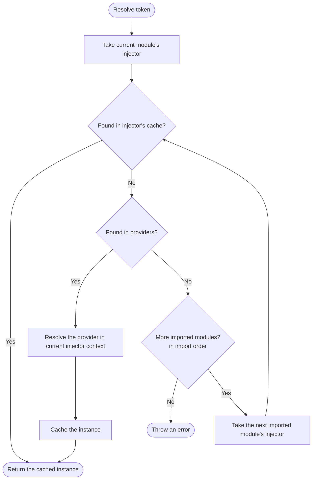

# CHO

A decorators based framework for TypeScript applications that runs in any runtime (Node.js, Deno, Bun, Cloudflare
Workers, etc.).

## Core

### Dependency Injection

DI used by modules that contain providers. Each module got its own DI injector for resolving dependencies and build its
own graph of providers. Module can import other modules and use their providers as dependencies using the imported
module's injector.

#### Search for dependencies in the following order:

- Module's own providers
- Imported modules' injectors (in the order of import)
    - As a result, this is a deep search for dependencies in the graph of modules and their providers (each injector
      also checks its imported modules' injectors for dependencies)

### Terminology

- `Provider` - a recipe for creating and injecting dependencies into controllers and services (dependency injection)
- `Controller` - an injectable class that contains methods as handlers for specific commands or routes (gateway)
- `Module` - DI and controllers container that can consume other modules

### Metadata Decorators

- add metadata to classes, methods, and properties
- retrieve metadata at runtime using reflection

### Entities

- `Method` - decorated method of a class as an handler for a specific command or route
- `Provider` - a recipe for creating and injecting dependencies into controllers and services (dependency injection)
- `Injectable` - decorated class that can be resolved and injected (service)
- `Controller` - decorated class that contains methods as handlers for specific commands or routes (gateway)
- `Module` - decorated class that contains controllers, providers, and other modules (module/application)

### Graph Builder

Build a graph of classes and their relationships based on metadata decorators.