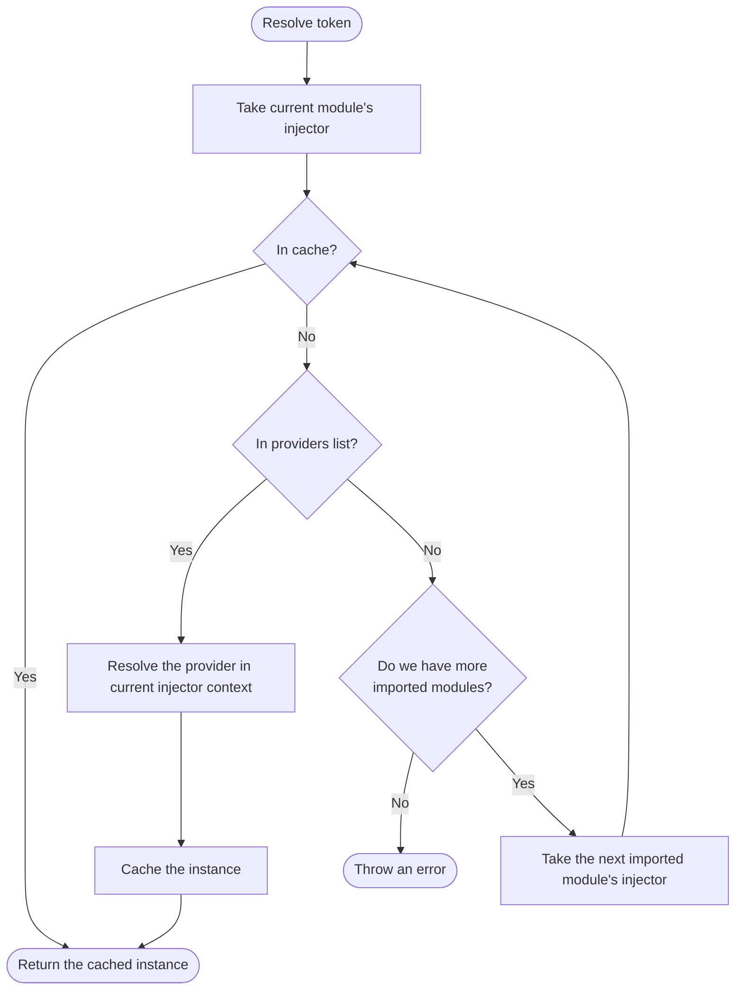

# CHO

A decorators based framework for TypeScript applications that runs in any runtime (Node.js, Deno, Bun, Cloudflare
Workers, etc.).

## Core

### Dependency Injection

#### Overview

DI is a mechanism for resolving dependencies and creating instances of classes or values. It allows for loose coupling
between components and makes it easier to manage dependencies in a large application.

#### Terminology

| Term       | Description                                                                                        |
|------------|----------------------------------------------------------------------------------------------------|
| Token      | a class constructor or an injection token (string or symbol) that is used to identify a dependency |
| Provider   | a recipe for creating an entity (class or value)                                                   |
| Injectable | a class that can be injected as a dependency or constructed by a provider                          |
| Module     | a container for providers and injectables that can import other modules                            |
| Injector   | a container that holds providers and resolves dependencies                                         |

#### Specifications

Each module has its own injector that is used to resolve its dependencies. The injector is responsible for creating
instances of providers and caching them for future use. The injector can also resolve dependencies from imported
modules, allowing for a hierarchical structure of modules and providers.

Injector lookup order is as follows:

- Injector's cache
- Module's own providers
- Imported modules' injectors (in the order of import)
- Not found: throw an error

When an imported module is used, the injector of the importing module will search for the provider and will be in charge
of creating the instance and caching it. Instances are cached per module, so if a provider is used in multiple modules,
each module will have its own instance of the provider (singleton per module).

Modules are importing and declaring providers, but they are not exporting them. Providers are available for all modules
that import the module that contains the provider. There is no concept of "private" providers (unlike JavaScript
modules).

For example, if module `A` imports module `B`, and module `B` imports module `C`, then module `A` can use providers from
module `C` without importing it directly.

flowchart:

- Start (resolve token)
- Set current modules as the own module
- Take current module's injector
- Check if the token is in the cache
    - If yes
        - Return the cached instance
    - If no
        - Check if the token is in the providers list
            - If yes
                - Resolve the provider in the current module context
                - Cache the instance
                - Return the instance
            - If no
                - Iterate over the imported modules in the order of import
                    - Set current module as the imported module
                    - Repeat the process
                - Throw an error if the token is not found in any module



---

DI used by modules that contain providers. Each module got its own DI injector for resolving its dependencies and build
its own graph of providers. Module can import other modules and use their providers as dependencies using the imported
module's injector. As a result, the DI search for dependencies is a deep search.

Module not need to export its providers to be used by other modules, each provider is available for all modules that
import the module that contains the provider (there is no "private" providers).

#### Search for dependencies in the following order:

- Injector's cache
- Module's own providers
- Imported modules' injectors (in the order of import)

#### Provider Definition

For simplicity there is only factory provider (implicit using constructors and explicit) that can be used to create an
instance of a class or any other value. The factory function is always async and get the current injector as an argument
to resolve its dependencies.

```ts
type Any = any;

type Ctr = new (...args: any[]) => any | Function;

type InjectionToken<T> = { token: string | symbol; };

type Token = InjectionToken<Any> | Ctr;

type Resolver = { resolve: <T>(token: Token) => Promise<T> };

type Factory<T = Any> = (injector: Resolver) => Promise<T>;

type Provider<T = Any> = { provide: InjectionToken<T> | Ctr; factory?: Factory<T>; };
```

##### Implementation Example

```ts

// example for service with no dependencies
@Injectable()
class Service {
}

// example for service with dependencies
@Injectable(["Config", Service])
class ApiService {
    constructor(private apiUrl: string, private service: Service) {
    }
}

@Module({
    imports: [
        OtherModule,
        AnotherModule,
    ],
    // registering providers
    providers: [
        // implicit provider definition
        Service,
        // explicit providers definition
        {
            provide: "Config",
            factory: (injector) => {
                return Promise.resolve({apiUrl: "https://api.example.com"});
            },
        },
        // implicit provider definition
        ApiService,
        // explicit (the same) providers definition
        {
            provide: ApiService,
            factory: async (injector) => {
                const config = await injector.resolve("Config");
                const service = await injector.resolve(Service);
                return new ApiService(config.apiUrl, service);
            },
        },
    ],
})
class SomeModule {
}
```

### Graph Builder

A function that take a module and build a graph of its modules, providers and controllers based on the metadata
decorators.

#### Graph Structure

The graph is a plain JS structure, not JSON:

- Constructors and factories are kept as values. They are the DI tokens and the recipes for creating instances, and
  JSON can't hold functions.
- Each module is built once. A module imported by several modules is a single node, and every importer holds a
  reference to that same node, so nothing is duplicated.

```ts
class ActionNode {
    constructor(
        public name: string,                  // method name on the controller's prototype
        public meta: Record<string, unknown>, // method decorators metadata (route, command, etc.)
    ) {
    }
}

class GatewayNode {
    constructor(
        public ctr: Ctr,                      // the controller class itself
        public deps: Token[],                 // constructor dependencies, resolved by the module's injector
        public meta: Record<string, unknown>, // controller decorators metadata (route prefix, etc.)
        public actions: ActionNode[],         // decorated methods only
        public middlewares: Token[],          // controller middlewares, resolved by the module's injector
    ) {
    }
}

class ModuleNode {
    constructor(
        public ctr: Ctr,                      // the module class itself
        public deps: Token[],                 // constructor dependencies, resolved by the module's injector
        public meta: Record<string, unknown>, // module decorators metadata
        public imports: ModuleNode[],         // references to the imported module nodes, in import order
        public providers: ProviderNode[],     // in registration order
        public gateways: GatewayNode[],
    ) {
    }
}

type MethodNode = {
    name: string;                  // method name on the controller's prototype
    meta: Record<string, unknown>; // method decorators metadata (route, command, etc.)
};

type ControllerNode = {
    ctr: Ctr;                      // the controller class itself
    deps: Token[];                 // constructor dependencies, resolved by the module's injector
    meta: Record<string, unknown>; // controller decorators metadata (route prefix, etc.)
    methods: MethodNode[];         // decorated methods only
};

type ProviderNode = {
    provide: Token;                // the token the provider is registered under
    factory: Factory;              // explicit factory, or generated from the constructor and its deps
    deps?: Token[];                // implicit providers only (explicit factories resolve their deps themselves)
};

type ModuleNode = {
    ctr: Ctr;                      // the module class itself
    imports: ModuleNode[];         // references to the imported module nodes, in import order
    providers: ProviderNode[];     // in registration order
    controllers: ControllerNode[];
};
```

##### Structure Example

The graph of `SomeModule` from the example above. Here `OtherModule` has a `UsersController` and `AnotherModule` also
imports `OtherModule`:

```js
const otherModuleNode = {
    ctr: OtherModule,
    imports: [],
    providers: [],
    controllers: [
        {
            ctr: UsersController,
            deps: [],
            meta: {route: "users"},
            methods: [
                {name: "list", meta: {route: "", type: "GET"}},
            ],
        },
    ],
};

const anotherModuleNode = {
    ctr: AnotherModule,
    imports: [otherModuleNode], // the same node reference
    providers: [],
    controllers: [],
};

const someModuleNode = {
    ctr: SomeModule,
    imports: [otherModuleNode, anotherModuleNode], // the same node references
    providers: [
        {
            provide: Service,
            factory: async (injector) => new Service(), // generated from the constructor (no deps)
            deps: [],
        },
        {
            provide: "Config",
            factory: (injector) => Promise.resolve({apiUrl: "https://api.example.com"}),
        },
        {
            provide: ApiService,
            factory: async (injector) => {
                const config = await injector.resolve("Config");
                const service = await injector.resolve(Service);
                return new ApiService(config.apiUrl, service);
            },
        },
    ],
    controllers: [],
};
```

